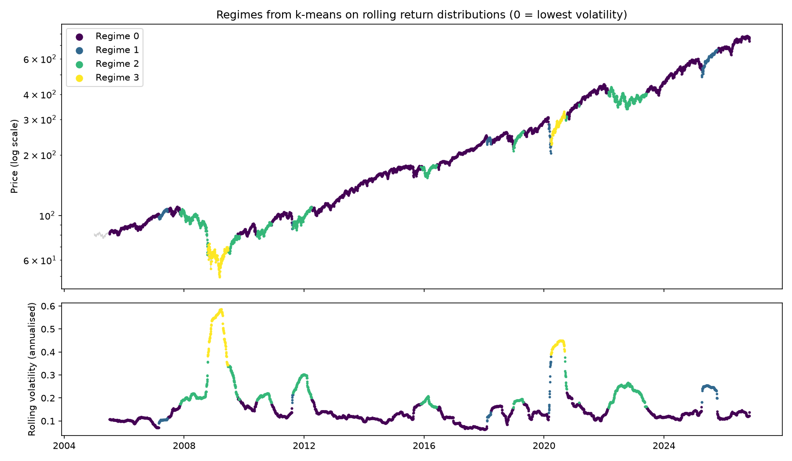

# Market Regime Clustering

[](https://github.com/shehzadahmed-gh/market-regime-clustering/actions/workflows/ci.yml)

Finds market regimes in SPY by clustering the distribution of daily returns over a rolling window, rather than individual days' returns. Each date is described by the shape of the last 126 days of returns, those descriptions are clustered with k-means, and each cluster is summarised by its annualised return, volatility, tail behaviour and typical duration. There's a command-line run that saves tables and charts, and a Streamlit app.

## Method

1. Download adjusted SPY closes from Yahoo Finance and take daily log returns.
2. For every date with 126 days of history, describe that window with 14 numbers: the 1st, 5th, 10th, 25th, 50th, 75th, 90th, 95th and 99th percentiles, the mean, volatility, skewness, excess kurtosis and the maximum drawdown inside the window. The percentiles are a coarse version of the window's quantile function, so Euclidean distance between two rows roughly compares the shapes of the two return distributions.
3. Standardise the 14 features and fit k-means (k = 4 by default, 20 initialisations).
4. Renumber the clusters by average volatility, so regime 0 is always the calmest. k-means numbers clusters arbitrarily, and this makes labels comparable between runs.
5. Summarise each regime and score k = 2 to 8 with silhouette, Calinski-Harabasz and Davies-Bouldin.

`fit_kmeans_regimes` fits the whole sample at once, so a date's label depends on later data. That is fine for describing history but not for trading on. `walk_forward_regimes` refits every 63 trading days using only data up to that day (after a three-year warm-up) and labels the next block with that fit; a test replaces all returns after a cut-off date and checks that earlier labels don't change.

## Results on SPY

Daily SPY closes from January 2005 to 6 November 2026, giving 5,371 windows (126 days each, k = 4).



| Regime | Share of days | Annualised return | Annualised volatility | Worst 1% day | Excess kurtosis | Max drawdown in window | Typical spell |
|---|---|---|---|---|---|---|---|
| 0 | 68% | +18.1% | 12.5% | −2.1% | 1.6 | −6.6% | 245 days |
| 1 | 5% | +9.8% | 18.9% | −3.9% | 13.6 | −13.6% | 53 days |
| 2 | 21% | −2.0% | 22.1% | −3.4% | 1.1 | −15.2% | 96 days |
| 3 | 5% | −35.6% | 47.6% | −8.7% | 3.6 | −36.2% | 143 days |

Each figure is the average over the 126-day windows that ended in that regime, so it describes the six months before a date, not what came after it.

- Regime 0, calm uptrend. Longest spells: 2005 to early 2007, 2012 to 2015, mid 2016 to January 2018, March 2021 to February 2022, mid 2023 to April 2025, and again since October 2025.
- Regime 1, a calm market hit by one shock. Every spell starts on a well-known one-day sell-off: 27 February 2007, 8 August 2011, 5 February 2018, 27 February 2020 and 4 April 2025. Volatility is moderate, but the single extreme day pushes kurtosis to 13.6. The April 2025 spell lasted 129 trading days, almost exactly the time it took the shock day to leave the 126-day window, so how long a spell lasts partly depends on the window length rather than on the market.
- Regime 2, correction. Longest spells: late 2007 to October 2008, mid 2010, August 2011 to March 2012, December 2015 to June 2016, December 2018 to April 2019, and the 2022 bear market (February 2022 to June 2023).
- Regime 3, crisis. Only two spells: October 2008 to June 2009 and March to September 2020.

On cluster count, silhouette is highest at k = 2 (0.60), which only separates calm periods from everything else. k = 4 and k = 5 score about the same (0.43); I use 4 because each regime has a clear economic meaning. Five different k-means seeds give almost the same partition (mean pairwise ARI 0.997).

The walk-forward labels, which only use data available at the time, agree with the full-sample labels on 49% of days since July 2008 (ARI 0.45). That gap is how much the full-sample labels rely on hindsight. Both versions put November 2026 in regime 0.

## Does it find real regimes?

There is no ground truth for SPY, so `scripts/validate_on_simulated.py` checks the method on simulated prices with three known regimes (calm, normal and stressed, with daily volatility of 0.7%, 1.2% and 2.8% and an average spell of about 100 days). It clusters with k = 3 and compares the labels with the true regime that covered most of each window, using the adjusted Rand index (ARI: 1 means identical partitions, 0 means no better than chance). Means over five seeds:

| Window | ARI, all 14 features | ARI, volatility only | Silhouette, all 14 features |
|---|---|---|---|
| 21 days | 0.448 | 0.616 | 0.461 |
| 63 days | 0.470 | 0.631 | 0.405 |
| 126 days | 0.352 | 0.390 | 0.432 |

Two things stand out:

- Clustering on volatility alone recovers the simulated regimes better than all 14 features. These regimes differ almost entirely in volatility, so after standardisation the other 13 features mostly add noise with equal weight. Real returns have fat tails and skew that change between regimes, so the full feature set may do better there, but this result means it has to earn its place.
- Silhouette doesn't track accuracy. The 126-day window scores a higher silhouette than the 63-day window while matching the true regimes less well: long windows blur short regimes into smooth, well-separated clusters that are wrong. So I don't pick k or the window by silhouette alone.

Different k-means seeds give almost the same partition (mean pairwise ARI of 0.95 on simulated prices), so the gap to the true regimes comes from the features and the method, not from random initialisation.

## Running it

```bash
python -m venv .venv && source .venv/bin/activate
pip install -r requirements.txt

python run_demo.py                          # SPY since 2005; tables and charts in outputs/
python -m streamlit run app.py              # interactive version
python scripts/validate_on_simulated.py     # the table above
pytest -q
```

If the Yahoo Finance download fails, `run_demo.py` falls back to simulated prices and says so. `outputs/` gets the regime label for every date (full-sample and walk-forward), the feature matrix, the regime summary, cluster-count scores, and two charts.

## Layout

```text
src/data.py              price download and the regime-switching simulator
src/regime_model.py      features, k-means, summaries, cluster scores, walk-forward labels
src/plots.py             regime and cluster-score charts
run_demo.py              command-line run
app.py                   Streamlit app
scripts/                 validation on simulated regimes
tests/                   unit tests, including the no-look-ahead check
```

## Limitations

- Overlapping windows share most of their data, so neighbouring rows are far from independent and clustering scores look better than they should.
- k-means assumes roughly spherical clusters of similar size, and has no notion of time or of how likely one regime is to follow another. A Gaussian mixture or a hidden Markov model would address both.
- The labels describe the past distribution of returns. Nothing here tests whether knowing the current regime helps predict future returns or risk; that would need an out-of-sample backtest using the walk-forward labels, with transaction costs.
- SPY alone; adding VIX, rates and credit spreads would give the clustering more to work with.
